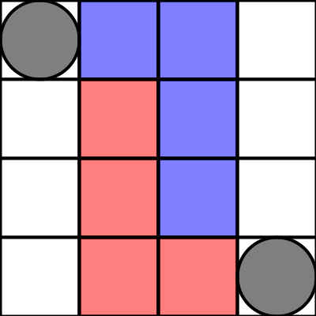

# L Game

Formulate two separate ways to find winning strategies for each player and analyze slight variations of the game using the same methods.

## Game Description
The L game is a strategic board game invented by Edward de Bono. It was introduced in his book The Five-Day Course in Thinking (1967).

## Board and Pieces
It is played on a 4 × 4 board. Each player has an L-shaped piece, which covers four squares. There are two neutral pieces covering one square each. Neutral pieces do not belong to the individual players but can be moved by either player.

## Starting Position
The diagram below shows the disposition of the pieces on the board at the beginning of the game.

## Moves
Each player in turn must move his L piece first to a new position. The piece may be picked up, turned around, turned right over, etc., and then placed on the board in a new position whatsoever. A position is deemed to be new even if only one of the squares covered by the piece has changed. The piece may be placed anywhere on the board so long as it covers an exact arrangement of squares and does not overlap another piece.

After the L piece has moved, a player may -- if he so wishes -- move either neutral piece to any unoccupied square on the board.

## Winning the Game
The objective of the game is to force the opponent into a position from which he cannot move. The game is won when the opponent cannot change the position of his L piece. (The L piece must always be moved before a neutral piece is touched)
